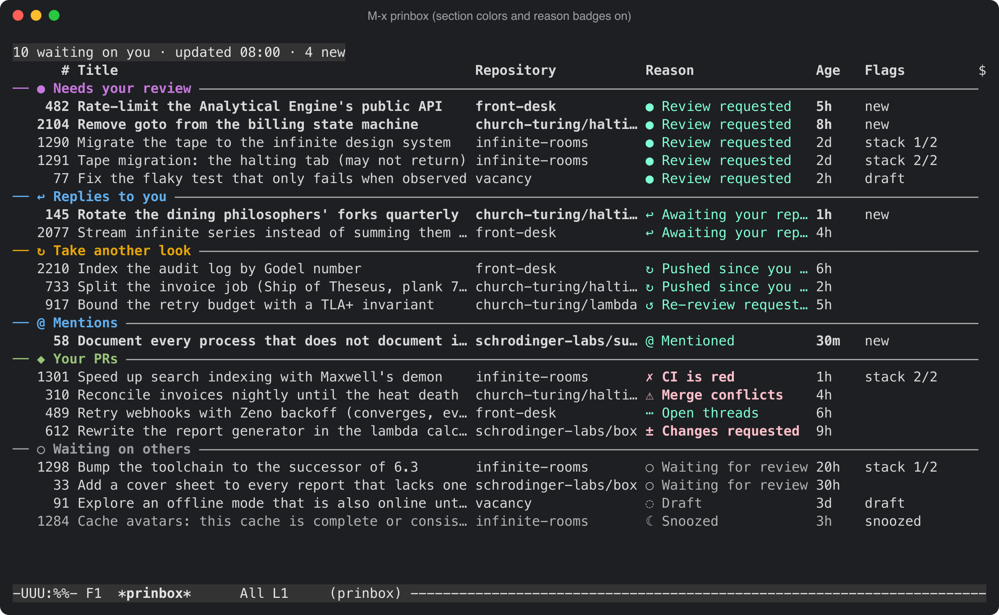

# prinbox for Emacs

The pull requests waiting on you, in a `tabulated-list` buffer, over the `prinbox` command. Requires Emacs 29.1
and prinbox 0.7.0 or later (`brew install creeonix/tap/prinbox-cli`, signed in through `gh auth login`).

## Install

```elisp
(use-package prinbox
  :vc (:url "https://github.com/creeonix/prinbox" :rev :newest)
  :commands (prinbox prinbox-mode-line-mode))
```

or `M-x package-vc-install RET https://github.com/creeonix/prinbox RET`. The repository is the package:
`prinbox.el` sits at its root.

## Use

<p align="center">
  
</p>


`M-x prinbox` opens `*prinbox*`: the cache at once, then a refresh in the background. Columns: Section, #, Title,
Repository, Reason, Age, Flags (`reviewing`, `notes` or `prep`, `new`, `draft`, `snoozed`, `stack i/n`); rows in the popover's order.

| Key | Does |
|---|---|
| `RET`, `b` | open the pull request with `browse-url`; on a `+N more on GitHub` line, the section on GitHub |
| `s` | snooze it until something happens on it (a push, a reply in your thread, a new review request) |
| `u` | wake it |
| `g`, `G` | fetch now |
| `y`, `w` | copy the URL `RET` would open |
| `M-n`, `M-p` | the first row of the next section; of this one, or the previous one |
| `a` | show or hide the Reviewed section (`prinbox-all`), then fetch |
| `r` | mark the review at point in progress, or clear the mark: it comes first in its section, bold and underlined, with `reviewing` in Flags; the mark lasts until you clear it or the pull request leaves the inbox (kept in `prinbox-in-progress-file`) |
| `v` | open your notes for the pull request at point: the first file in `prinbox-review-notes-marks` (`review.md`), else its directory in Dired |
| `n`, `p`, `q`, `?` | the usual list keys: next, previous, bury the buffer, describe the mode |

The keys follow Emacs list modes: `b` and `G` as in Elfeed (browse, fetch), `y` as in Elfeed's copy link, `M-n` and
`M-p` as in Magit's sibling sections, and `s`/`u` as a do/undo pair, like Magit's stage and unstage.

The header line reads `8 waiting on you · updated 14:02 · 4 new`, with your default repositories appended when
some are set in PRInbox, and the error line when the last fetch failed. A snooze made here shows in the menu bar
and the popover within a second, and the other way round. Enter on a row whose diff moved since your review opens
GitHub's diff since that review.

With `prinbox-reason-badges` set, the Reason column takes its tone from the reason, as the app does: CI is red, merge conflicts and changes requested
show as a red badge (`prinbox-reason-failure`), Ready to merge as a green one (`prinbox-reason-success`), reasons
that wait on someone else are dimmed (`prinbox-reason-neutral`) and the rest use `prinbox-reason-attention`. Snoozed
rows stay dim.

## Options

| Custom | Default | Meaning |
|---|---|---|
| `prinbox-icons` | `nil` | icons before each reason: `unicode` (one-column symbols any font has) or `nerd` (Octicons through the nerd-icons package and a Nerd Font, falling back to Unicode) |
| `prinbox-command` | `"prinbox"` | the executable |
| `prinbox-section-separator` | `nil` | between sections: `rule` (a line naming the section), `blank`, or nil |
| `prinbox-section-repeat-label` | `show` | the section label on a section's later rows: `show`, `dim` or `hide` |
| `prinbox-section-faces` | `nil` | the face of each section's label by kind; `prinbox-section-kind-faces` gives one color per section |
| `prinbox-max-age` | `60` | the buffer serves the cache when GitHub confirmed it within this many seconds |
| `prinbox-section-column` | `t` | nil drops the Section column; a rule then names each section |
| `prinbox-all` | `nil` | list every pull request you reviewed |
| `prinbox-rows` | `nil` | rows per section before `+N more on GitHub`; nil keeps the command's 8 (needs a command with `--rows`) |
| `prinbox-poll-seconds` | `0` | seconds between background refreshes for the mode line; 0 is off |
| `prinbox-reason-badges` | `nil` | color the Reason column by tone (badges for failures and Ready to merge) |
| `prinbox-default-owners` | `nil` | owners whose `owner/` prefix the Repository column drops: a list, or `auto` for the one owner in the inbox besides you; nil reads `defaultOwners` from `$XDG_CONFIG_HOME/prinbox/settings.json` (links are unchanged) |
| `prinbox-review-order` | `nil` | order of the review sections' rows: nil keeps the command's (longest waiting first), `recent` newest first, `quick` small PRs first (up to 50, 250, 1000 changed lines, then larger) and newest first within a size, `small-first` smallest first; a stack moves as one block |
| `prinbox-review-drafts` | `show` | drafts in the review sections: `show` in place, `last` after the rest, `hide` |
| `prinbox-review-direct-first` | `nil` | review requests that name you come before ones that reached you through a team or as a code owner; asks GitHub through `gh` (one GraphQL search per `prinbox-max-age`), since the command does not report this |
| `prinbox-reviewers` | `nil` | a Reviewers column after Flags: the other reviewers, changes requested `±` first, then approved `✓`, pending requests `○`, commented `✎` and `@team`; asks GitHub through `gh` (one GraphQL query for the rows shown per `prinbox-max-age`); takes effect when the buffer is next created |
| `prinbox-review-notes-directory` | `nil` | where a review tool keeps notes per pull request: a prefix, under which they are in `OWNER/REPO/NUMBER/` (each part made directory-safe); a value with `%` is a template instead (`%o`, `%r`, `%n`); a list tries each in turn, the first existing directory winning; when it exists Flags shows a mark and `v` opens it; prinbox only reads it |
| `prinbox-review-notes-marks` | `(("review.md" . "notes") (nil . "prep"))` | the Flags mark per file, first non-empty match wins; nil means the directory alone |
| `prinbox-gh-command` | `"gh"` | the GitHub CLI, used by `prinbox-review-direct-first` and `prinbox-reviewers` |

## Mode line

`(prinbox-mode-line-mode 1)` adds ` PR:8` to the mode line (nothing when nothing waits, `PR:!` or `PR:!8` after a
failed fetch) and, with `prinbox-poll-seconds` set, keeps it fresh.

## When something is wrong

| What you see | Why |
|---|---|
| `prinbox not found: brew install creeonix/tap/prinbox-cli` | the command is not on Emacs's `exec-path`; set `prinbox-command` |
| the sign-in steps in place of the rows | gh is signed out: `gh auth login` |
| `· GitHub did not answer in time` in the header line | the fetch failed; the rows are the last known ones |
| `prinbox prints JSON version N; this plugin reads version 1` | the command is newer than the package: update it |

The package reads only what the command prints: titles, logins, URLs, counts and dates, never comment text.
